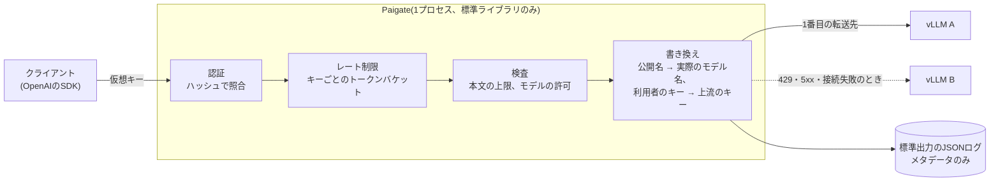

# Paigate

[English](README.md) | **日本語**

小さく、監査しやすい、OpenAI互換のAIゲートウェイです。
vLLMなど自前ホストのLLMの前に置き、仮想キーでの認証、モデルの許可、レート制限、フォールバック、利用の記録を行います。

- **外部依存ゼロ**: Goの標準ライブラリだけで書いています(`go.sum`がありません)
- **コードが小さい**: 本体は約1,000行。全部を読んで承認できます
- **プロンプトを記録しない**: ログに残るのは、キーの名前、モデル、トークン数、時間などのメタデータだけです

## 使い方

```sh
go install paibot.app/paigate/cmd/paigate@latest

paigate genkey                 # 仮想キーとハッシュを作る。キーは利用者に一度だけ渡す
cp paigate.example.json paigate.json   # hash を書き換える
paigate check -config paigate.json
paigate serve -config paigate.json
```

クライアントからは、OpenAIのSDKのbase URLを変えるだけで使えます。

```sh
curl http://localhost:8080/v1/chat/completions \
  -H "Authorization: Bearer $PAIGATE_KEY" \
  -H "Content-Type: application/json" \
  -d '{"model":"chat","messages":[{"role":"user","content":"こんにちは"}]}'
```

対応しているエンドポイント: `POST /v1/chat/completions`、`POST /v1/completions`、`POST /v1/embeddings`、`GET /v1/models`、`GET /healthz`。Anthropic のクライアント向けに `POST /v1/messages` と `POST /v1/messages/count_tokens`。それ以外は404を返します。

### Claude など Anthropic 形式の上流

上流に `"api": "anthropic"` と書き、Anthropic の公式SDKの接続先をPaigateにします。仮想キーは、SDKが送る `x-api-key` でも、`Authorization: Bearer` でも受け付けます。

```json
"upstreams": {
  "claude": { "base_url": "https://api.anthropic.com/v1", "api": "anthropic", "api_key_env": "ANTHROPIC_API_KEY" }
},
"models": {
  "sonnet": { "targets": [{ "upstream": "claude", "model": "claude-sonnet-4-5" }] }
}
```

```python
client = anthropic.Anthropic(api_key=PAIGATE_KEY, base_url="http://localhost:8080")
client.messages.create(model="sonnet", max_tokens=1024, messages=[...])
```

リクエストは形式を変換せず、そのまま中継します。そのため、Anthropicの新しい機能もPaigateを直さずに使えます。同じ理由で、1つのモデルの転送先はすべて同じ `api` にそろえる必要があります。また、AnthropicのモデルをOpenAIのエンドポイントで呼ぶことはできず、その逆もできません。このエンドポイントのエラーはAnthropicと同じ形で返します。529(混雑)のときは、5xxと同じく次の転送先に進みます。ログの `prompt_tokens` には、OpenAIと同じくキャッシュから読んだ入力も含めます。

## アーキテクチャ



リクエストは、この4段階を順に通ります。どこかで止まったら、その場でOpenAIと同じ形のエラーを返すので、SDKでは普通のエラーとして扱えます。応答は溜めずにそのまま流し、流れる途中でトークン数を読み取ります。

| ファイル | 役割 |
|---|---|
| [`cmd/paigate/main.go`](cmd/paigate/main.go) | コマンド(`serve`、`check`、`genkey`、`hash`)、HTTPサーバーの時間制限、安全な停止 |
| [`internal/gateway/config.go`](internal/gateway/config.go) | 設定のJSONの読み込みと、厳しめの検査 |
| [`internal/gateway/keys.go`](internal/gateway/keys.go) | キーの生成とハッシュ、トークンバケットによる制限 |
| [`internal/gateway/gateway.go`](internal/gateway/gateway.go) | 振り分け、認証、フォールバックつきの転送、SSEの中継、利用の記録 |

状態はメモリの中だけにあります。読み込んだ設定と、キーごとのレート制限のバケットです。データベースも、裏で定期的に動く処理もありません。リクエストの流れの外で、見えない処理が動くことはありません。

## 設定

[paigate.example.json](paigate.example.json) を参照してください。

| 項目 | 内容 |
|---|---|
| `upstreams` | 転送先。`base_url`はhttpかhttpsのみ。上流のAPIキーは`api_key_env`で指定した環境変数から読みます。`api`は`openai`(既定)か`anthropic` |
| `models` | 公開するモデル名と、転送先の一覧。上から順に試し、429と5xx、接続失敗のときだけ次へ進みます |
| `keys` | 仮想キー。`hash`(SHA-256)だけを置きます。`models`で使えるモデルを限定し、`rpm`で1分あたりの回数を制限します |

設定の書き間違い(知らない項目、存在しない転送先、ハッシュの形式違いなど)は、起動時にエラーになります。
制限が書き間違いで無効になったまま動く、ということを防ぐためです。

## 安全のための設計

- 仮想キーは256ビットの乱数で、ハッシュだけを保存します。照合はハッシュで行うので、比較時間からキーを推測できません
- クライアントのヘッダーは転送しません(例外は`Accept`と、Anthropicの上流への`anthropic-version`と`anthropic-beta`)。上流には、新しく作ったリクエストに上流用のキーを付けて送ります
- 上流からのリダイレクトはたどりません。内部の別のアドレスへ誘導されるのを防ぎます
- 環境変数のプロキシ設定は使いません
- 本文の大きさに上限があります(既定は10MB)。ヘッダーの読み込みにも時間の上限があります
- 存在しないモデルと許可されていないモデルには、同じ404を返します。キーを使って他のモデルを探ることはできません
- コンテナは、ダイジェストで固定したdistrolessの上で、root以外のユーザーとして動きます。CIのアクションもコミットのSHAで固定しています

## まだないもの

- レート制限は各プロセスのメモリ内です。複数のレプリカで共有するにはRedisが必要です
- 予算(トークン数や金額の上限)と、利用記録のPostgreSQLへの保存
- TLSの終端(Ingressで行う前提です)
- 管理API。キーの追加と削除は、設定を書き換えて再起動します
