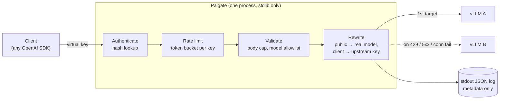

# Paigate

**English** | [日本語](README.ja.md)

**An AI gateway small enough to read in one sitting.**

Paigate sits in front of your self-hosted LLMs (vLLM, SGLang, anything OpenAI-compatible) and does what a gateway should do, and nothing more: it checks virtual keys, enforces per-key model access and rate limits, falls back across upstreams, and records who used what. It never records what they said.

```
zero dependencies   ·   ~1,000 lines   ·   no prompts in logs   ·   one static binary
```

## Why

An AI gateway holds the keys to every model you run, and sees every prompt that passes through. It should be the most boring, most auditable piece of your stack.

Most gateways went the other way: hundreds of transitive dependencies, plugin systems, admin UIs, and dozens of provider integrations. Each one is more code to trust. When that supply chain gets compromised, a gateway is exactly where an attacker wants to be.

Paigate goes the other way:

- **Standard library only.** No `go.sum`. Nothing to pin, vendor, or audit beyond Go itself. CI fails if a dependency ever appears.
- **Small on purpose.** The whole gateway is about 1,000 lines. You can review all of it before you approve it.
- **Metadata, not content.** Logs carry key name, model, upstream, status, token counts and latency. Prompts and completions never touch disk.
- **Fails loud.** Unknown config fields, dangling references, malformed hashes, and missing secrets all stop startup. A typo never silently disables a limit.

## Quick start

```sh
go install paibot.app/paigate/cmd/paigate@latest

paigate genkey                          # mint a virtual key; hand it out once, keep only the hash
cp paigate.example.json paigate.json    # paste the hash in
paigate check -config paigate.json
paigate serve -config paigate.json
```

Point any OpenAI SDK at it by changing the base URL:

```sh
curl http://localhost:8080/v1/chat/completions \
  -H "Authorization: Bearer $PAIGATE_KEY" \
  -H "Content-Type: application/json" \
  -d '{"model":"chat","messages":[{"role":"user","content":"Hello"}]}'
```

Endpoints: `POST /v1/chat/completions`, `POST /v1/completions`, `POST /v1/embeddings`, `GET /v1/models`, `GET /healthz`, and for Anthropic clients `POST /v1/messages` and `POST /v1/messages/count_tokens`. Everything else is a 404.

### Claude and other Anthropic-format upstreams

Mark the upstream with `"api": "anthropic"` and point the official Anthropic SDK at Paigate. The virtual key can go in `x-api-key`, as the SDK sends it, or in `Authorization: Bearer`.

```json
"upstreams": {
  "claude": { "base_url": "https://api.anthropic.com/v1", "api": "anthropic", "api_key_env": "ANTHROPIC_API_KEY" }
},
"models": {
  "sonnet": { "targets": [{ "upstream": "claude", "model": "claude-sonnet-4-5" }] }
}
```

```python
client = anthropic.Anthropic(api_key=PAIGATE_KEY, base_url="http://localhost:8080")
client.messages.create(model="sonnet", max_tokens=1024, messages=[...])
```

Requests are passed through in their own format, never translated, so new Anthropic features work without changes to Paigate. That is also why a model's targets must all use the same `api`, and why an Anthropic model is refused on the OpenAI endpoints and the other way round. Errors on these endpoints come back in Anthropic's shape, and a 529 (overloaded) moves on to the next target like a 5xx. Logged `prompt_tokens` include cached input, as OpenAI's do.

## Architecture



Each request goes through four checks in order. The first one that fails ends the request with an OpenAI-shaped error, so SDKs surface it normally. Responses stream back unbuffered, and token usage is read as the response passes through.

| File | Role |
|---|---|
| [`cmd/paigate/main.go`](cmd/paigate/main.go) | CLI (`serve`, `check`, `genkey`, `hash`), HTTP server timeouts, graceful shutdown |
| [`internal/gateway/config.go`](internal/gateway/config.go) | Strict JSON config loading and validation |
| [`internal/gateway/keys.go`](internal/gateway/keys.go) | Key generation, hashing, token-bucket limiter |
| [`internal/gateway/gateway.go`](internal/gateway/gateway.go) | Routing, auth, proxying with fallback, SSE relay, usage logging |

State lives in memory only: the parsed config and one rate-limit bucket per key. There is no database and no background job: nothing runs outside the request path.

## Configuration

One JSON file. See [paigate.example.json](paigate.example.json).

| Field | What it does |
|---|---|
| `upstreams` | Where requests go. `base_url` must be http or https with no embedded credentials. Upstream API keys come from the environment variable named in `api_key_env`, never from the file. `api` is `openai` (the default) or `anthropic`. |
| `models` | Public model names mapped to an ordered list of targets. Paigate moves to the next target only on 429, 5xx, or a connection failure, and only to targets you listed. |
| `keys` | Virtual keys, stored as SHA-256 hashes. `models` limits what each key may call; `rpm` caps requests per minute. |

## Security model

- **Keys.** 256-bit random keys, stored only as hashes. Lookup is by hash, so comparison timing reveals nothing about a guess.
- **Clean upstream requests.** Every upstream request is built from scratch. The client's credentials, cookies, and forwarding headers are dropped. Only `Accept` passes through, plus `anthropic-version` and `anthropic-beta` to Anthropic upstreams. The upstream's own key is attached server-side.
- **No redirects.** Upstream redirects are returned as-is, never followed, so an upstream cannot bounce Paigate into your internal network.
- **No ambient proxies.** `HTTP_PROXY` and friends are ignored.
- **Bounded input.** Request bodies are size-capped (10 MB by default). Header reads are time-boxed.
- **No model discovery.** A model that doesn't exist and a model the key can't use return the same 404.
- **Hardened delivery.** Distroless, non-root container with base images pinned by digest. CI actions are pinned by commit SHA, run with read-only permissions, and get no secrets.

## Not yet

- Rate limits are per process. Sharing them across replicas needs Redis.
- Budgets (token or spend caps) and persisting usage to PostgreSQL.
- TLS termination. Run Paigate behind your ingress.
- An admin API. To change keys, edit the config and restart.

Small is the feature. Additions will be judged by what they cost to audit.
